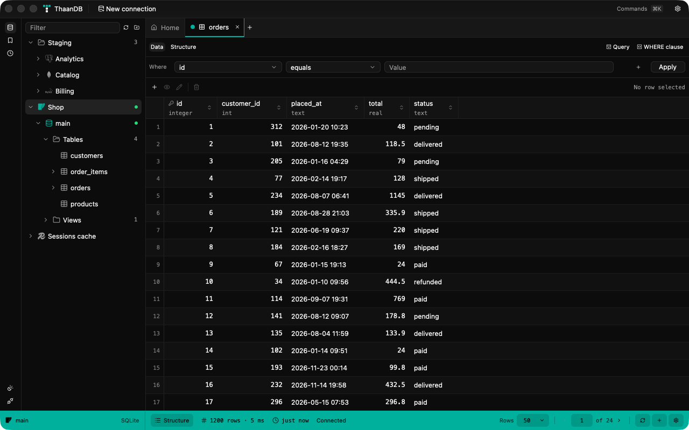
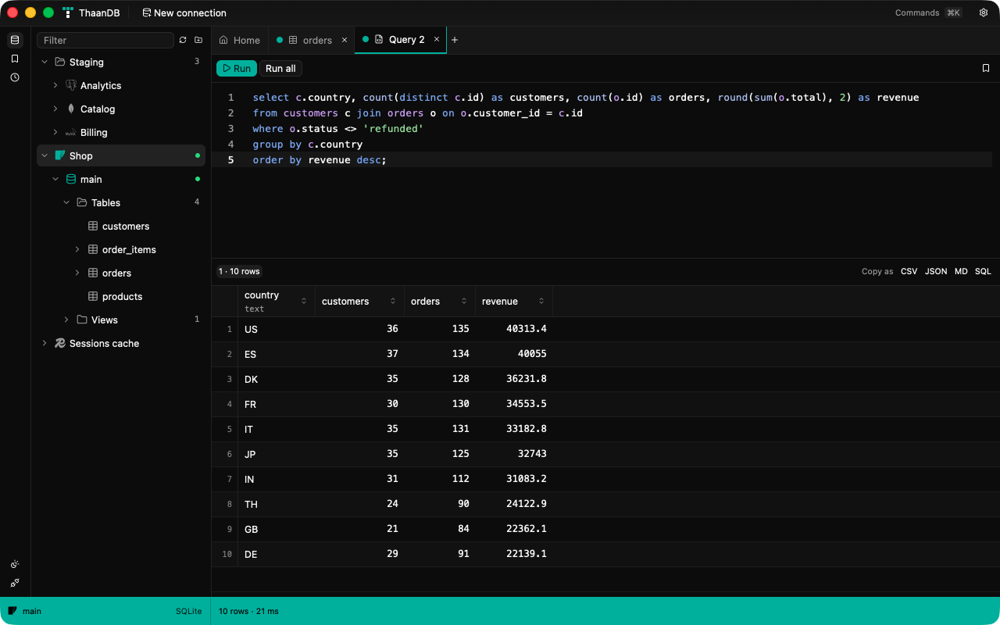
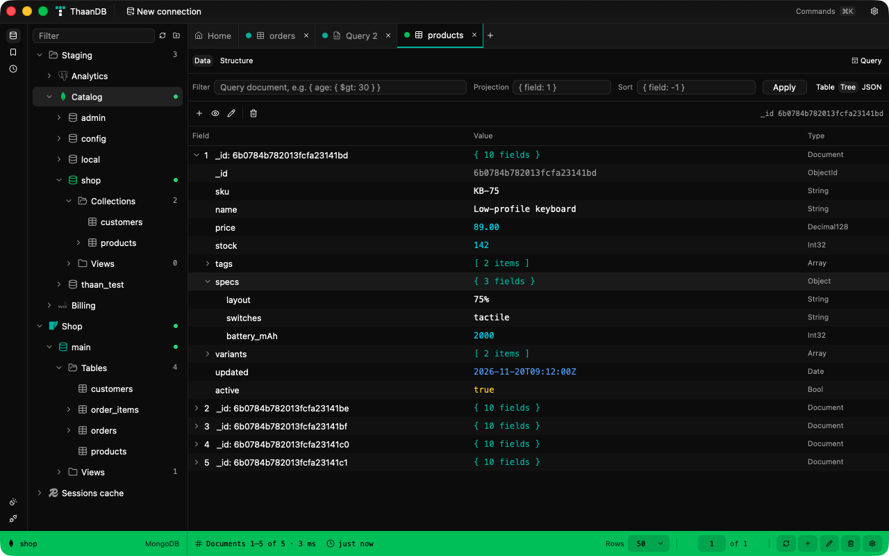
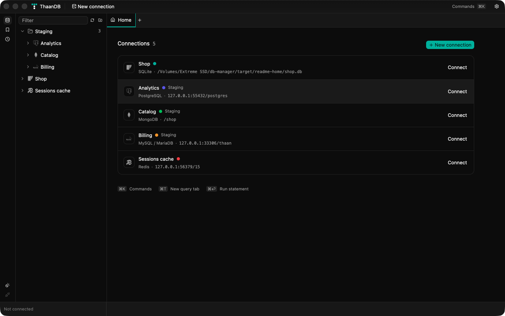

<p align="center">
  <picture>
    <source media="(prefers-color-scheme: dark)" srcset="docs/brand/logo/thaandb-horizontal-on-dark.svg">
    
  </picture>
</p>

<p align="center">
  A native desktop database client for SQLite, PostgreSQL, MySQL, MongoDB, Redis and MQTT.<br>
  Written in Rust on GPUI. Open source under Apache-2.0.
</p>

<p align="center">
  <a href="https://github.com/watchakorn-18k/thaanDB/releases/latest">Download</a> ·
  <a href="docs/spec/features.md">Features</a> ·
  <a href="docs/mcp.md">MCP server</a> ·
  <a href="https://github.com/watchakorn-18k/thaanDB/issues">Issues</a>
</p>

<p align="center">
  
</p>

ThaanDB (from ฐาน, "base") is a database manager that opens instantly and stays light on
memory. It runs as a native app drawn on the GPU, not a web page in a browser shell. Tables
load one page at a time, and slow work like connecting, querying and exporting runs off the
UI thread, so the window does not freeze.

The same engine also runs headless: a `thaan` command-line client and an MCP server let
scripts and AI agents use your saved connections.

## What it does

- **Connections.** Save connections with a name and colour, group them in folders and
  duplicate them. Paste a URL like `postgres://…` to fill the form. Passwords go to the OS
  keychain, never into the config file.
- **Schema browser.** Tables, views, indexes, triggers and sequences load as you expand
  them. You can filter by name and right-click to rename, duplicate, truncate or drop,
  with a confirmation first.
- **Query editor.** SQL with syntax highlighting. Run the statement under the cursor
  (`⌘↵`) or all of them. Every run goes into history, and you can save queries.
- **Data grid.** Virtualized rows with server-side sort and paging, plus a filter builder
  or a raw `WHERE` clause. Copy as CSV, JSON, Markdown or SQL `INSERT`.
- **Editing.** Cell edits, inserts and deletes are staged, shown as SQL, and applied in one
  transaction. Read-only connections refuse writes in the engine, not only in the UI.
- **Structure.** View and change columns, indexes and foreign keys, see triggers, and
  read the `CREATE` statement.
- **Data transfer.** Copy tables or collections between any two connections, structure and
  rows, across engines.
- **Command palette** (`⌘K`) over every command, plus light and dark themes.

## Databases

| Database | Browse | Query | Edit |
| --- | --- | --- | --- |
| SQLite | Tables, views, indexes, triggers | SQL | Staged, one transaction |
| PostgreSQL | Schemas, sequences, routines | SQL, TLS via `sslmode` | Staged, one transaction |
| MySQL / MariaDB | Databases, routines | SQL | Staged, one transaction |
| MongoDB | Collections, views, indexes, inferred schema | Shell syntax: `db.orders.find({ total: { $gt: 100 } })` | Staged `$set` / insert / delete |
| Redis | Keys grouped by `:`, with type and TTL | Commands, one per line | Staged, run in `MULTI` / `EXEC` |
| MQTT | Subscribed topics and messages | `PUBLISH`, `SUBSCRIBE`, `MESSAGES` | Publish from the grid |

What is done and what is still planned for each feature is tracked in
[`docs/spec/features.md`](docs/spec/features.md).

## Screenshots

<table>
  <tr>
    <td width="50%"></td>
    <td width="50%"></td>
  </tr>
  <tr>
    <td>Query editor with results under it</td>
    <td>MongoDB collection in tree view</td>
  </tr>
  <tr>
    <td colspan="2"></td>
  </tr>
  <tr>
    <td colspan="2">Saved connections, grouped in folders</td>
  </tr>
</table>

## Install

Download the latest build from
[Releases](https://github.com/watchakorn-18k/thaanDB/releases/latest):

- **macOS** (Apple Silicon and Intel): `ThaanDB-v<version>-macos-universal.zip`. The app is
  not code-signed yet, so clear the quarantine flag once after unzipping:

  ```bash
  xattr -dr com.apple.quarantine /Applications/ThaanDB.app
  ```

- **Windows** (x64): `ThaanDB-v<version>-windows-x64.zip`, with `ThaanDB.exe` and the
  `thaan.exe` command-line client.
- **Linux**: no prebuilt package yet. Build from source as shown below.

Each release lists SHA-256 checksums in `SHA256SUMS.txt`.

## Build from source

You need a stable Rust toolchain. The first build of the app compiles GPUI and takes a few
minutes.

```bash
git clone https://github.com/watchakorn-18k/thaanDB.git
cd thaanDB
cargo run --release -p thaan-app
```

On macOS, `scripts/bundle-macos.sh --release` builds `target/ThaanDB.app` with its icon.

## Command line

`thaan` gives headless access to the same engine and the same saved connections:

```bash
cargo build --release -p thaan-cli
thaan query sqlite:./shop.db "select country, count(*) from customers group by 1"
thaan tables postgres://postgres@127.0.0.1/app
thaan export mysql://root@localhost/app orders --format csv --out orders.csv
thaan commands     # every command id, also callable with `thaan run <id>`
```

## MCP server for AI agents

`thaan mcp` lets Claude Code, Claude Desktop, Cursor and other MCP clients list your
connections, read schemas, run queries and open tables in the ThaanDB window. Agents never
see a saved password: secrets are masked in every reply. To keep an agent from writing to a
connection, mark that connection read-only.

```bash
claude mcp add thaandb -- /Applications/ThaanDB.app/Contents/MacOS/thaan mcp
```

**Settings › MCP** in the app shows the exact setup for each client with your paths filled
in. Tools and details are in [`docs/mcp.md`](docs/mcp.md).

## Project layout

```
crates/
  thaan-core/             engine: commands, dialects, driver trait, statement splitter,
                          export, history, MCP protocol (no GUI)
  thaan-driver-*/         sqlite, postgres, mysql, mongodb, redis, mqtt
  thaan-keychain/         OS keychain for saved passwords
  thaan-cli/              the `thaan` binary and `thaan mcp`
  thaan-app/              the desktop app (gpui-kit)
docs/                     feature spec, UI spec, MCP, releasing, brand
```

Every action in the app is a command with a stable id such as `query.runAll` or
`table.fetchPage`. The menu, palette, CLI and MCP server all dispatch the same commands, so
anything the app can do can also be tested and scripted without it. More in
[`AGENTS.md`](AGENTS.md).

## Issues welcome, pull requests closed

**This project does not accept pull requests.** Pull requests are closed without review.

ThaanDB is maintained by one person, who does not have the time to review outside code
line by line. A database client holds passwords and has direct access to people's data, so
code nobody has reviewed is a real risk: one hidden change could steal credentials or ship
malware to everyone who installs the next release. Taking no outside code is the simplest
way to keep every release safe.

[Issues](https://github.com/watchakorn-18k/thaanDB/issues) are welcome:

- **Bugs.** Say what you did, what you expected and what happened instead. Include your
  OS, the ThaanDB version and the database you were connected to (for example
  PostgreSQL 17). Leave out passwords, hostnames and real data.
- **Feature requests.** Describe what you want to do, not just the button you want.
- **Security problems.** Do not post a working exploit in a public issue. Open an issue
  that asks for a private contact and leave the details out.

You are free to fork ThaanDB and change it under the [Apache License 2.0](LICENSE).
Project rules for building and testing are in [`AGENTS.md`](AGENTS.md).

## Licence

[Apache License 2.0](LICENSE). Database logos are from [Simple Icons](https://simpleicons.org)
(CC0) and are trademarks of their owners. Interface icons are [Lucide](https://lucide.dev) (ISC).
